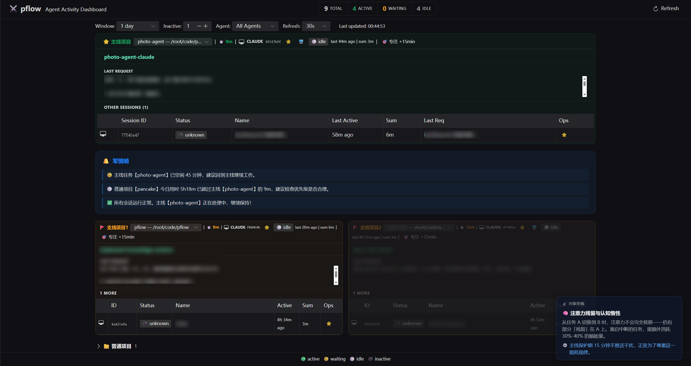

# pflow

English | [中文](./README.md)

**Multi-Agent Attention Management & Orchestration Tool**

## Have you ever run into these problems?

- Claude is coding, Hermes is writing docs — which one finishes first, and which window should you check?
- You switch to another window for a while, come back, and forget which Agent is waiting for your approval — so you start scanning terminals one by one.
- AI sessions for different projects are scattered across different terminals and tmux sessions, with no unified view of the "big picture."

pflow aggregates the state of all these AI sessions onto a single dashboard. Like a general looking at a sandtable, you see at a glance which front is fighting, which is waiting, and where you need to go.

Knowledge cards rotate through five candidates: knowledge linked to all current action suggestions is deduplicated and preferred, then the full pool fills remaining slots at random. Without suggestions, all five are sampled randomly. In Settings, open **自定义知识点**, add a title and body with an optional application note, then click **保存设置**. Custom knowledge joins the pool and can be edited or deleted; selection is not guaranteed every time. Content is persisted in the server's `~/.pflow/settings.json`.

## Dashboard Preview



## Quick Start

```bash
# Launch Web Dashboard (visit http://localhost:10002 in your browser)
pflow serve

# Start a managed Claude session in the current project (tmux auto-configured)
pflow claude -dir .

# Get today's attention recommendations (focus / switch / approval reminders)
pflow suggest
```

Managed sessions configure mouse scrolling at runtime: wheel events pass through when the application handles the mouse, and otherwise scroll tmux history. No edits to `~/.tmux.conf` are needed; other tmux sessions keep their settings. For an existing managed session, detach with `Ctrl+B`, then `D`, and reconnect using the original launch command with the updated pflow binary. The Agent can keep running.

## Windows Desktop

Build on Linux with system Go, pnpm, project dependencies and the MinGW-w64 compiler (`x86_64-w64-mingw32-gcc`):

```bash
make build-windows
```

Copy `bin/pflow.exe` to Windows and double-click it. WebView2 Runtime is required; Go, Node.js and the source tree are not. On first launch, enter the HTTP/HTTPS URL of a Linux `pflow serve`. Use **连接设置** at the top to change services. Projects, schedules and preferences are managed by the selected Linux service. The desktop stores its address in `%USERPROFILE%\.pflow\desktop.json` and logs in `%USERPROFILE%\.pflow\logs\desktop.log`. Closing the window exits the application.

- Local Docker: run pflow in the Agent container and publish the port, e.g. `-p 127.0.0.1:10002:10002`; connect to `http://127.0.0.1:10002`. Sharing the Agent container lets pflow read its data, inspect its PID and access tmux.
- Local WSL: run pflow in the Agent distribution; Windows can usually connect to `http://127.0.0.1:10002`.
- Remote Linux: use an existing protected HTTP/HTTPS endpoint or your own SSH tunnel. For example, run `ssh -N -L 127.0.0.1:11002:127.0.0.1:10002 user@host` and connect to `http://127.0.0.1:11002`. The remote port must be reachable from the SSH host; stop the tunnel with Ctrl+C. The desktop does not manage SSH processes.

The current API has no authentication, so use local port publishing, an existing protected network or an SSH tunnel. This release connects to one service and disables desktop Web terminals; use your existing terminal for Agent interactions. Linux browser terminals continue to work. Future local Agent and multiple remote source fusion is tracked in [backlog #55](./docs/backlog.md#55-future本地与多远端会话融合).

## Core Experience

| Scenario | What pflow does |
|----------|-----------------|
| Start an Agent session | `pflow claude -dir .` → tmux + Agent auto-configured, appears on Dashboard instantly |
| See multi-session status at a glance | Dashboard traffic lights: 🟢 Busy / 🟡 Waiting / ⚪ Idle |
| Agent needs approval | One click in the sidebar → Web terminal attaches to the same tmux session, press `1` to confirm |
| What to focus on today | Primary/Secondary strategy + reminder score algorithm → `pflow suggest` tells you next step |

## Why pflow

- **Not yet another Agent**: pflow doesn't do conversation — it does orchestration. It helps you use multiple Agents effectively, rather than burning mental energy switching between them.
- **Non-intrusive workflow**: Use Claude Code, Hermes normally in the terminal — they show up on the Dashboard automatically, without changing how you work.
- **One-click access**: From "seeing the state" to "interacting with the session" takes a single click. No more copy-pasting commands or manually attaching to tmux.

## Implemented Core Capabilities

- **Multi-Agent Monitoring**: Claude Code & Hermes dual-engine support, real-time status sync
- **Project Strategy Management**: Primary/Secondary task mapping + reminder score algorithm + attention overlay
- **Web Terminal Integration**: Dashboard sidebar one-click attach to Agent sessions (via ttyd + tmux)
- **Attention Guidance**: Focus mode protection period + Attention Commander suggestion engine (~20 static scenarios)
- **Complete Documentation**: PRD, technical design, backlog, test strategy all included

## Tech Stack

| Layer | Technology |
|-------|------------|
| CLI Framework | Go standard library (hand-written subcommand dispatch) |
| Web Dashboard | Vue 3 + Naive UI (Go embed single-binary deployment) |
| Backend | Go (tmux management, state scanning, session mapping) |
| Agent Integration | Claude Code (statusline + JSON scanning), Hermes (export parsing) |

## Roadmap

- [x] Dual-Agent status monitoring + Web Dashboard
- [x] Project strategy management + reminder score algorithm + attention overlay
- [x] Web terminal integration + Focus Mode
- [x] Attention Commander suggestion engine (static scenarios)
- [ ] Desktop notifications (Browser Notification API)
- [ ] Attention Commander proactive push + preference learning
- [ ] Dual-layer skinning system

## Documentation

| Document | Purpose |
|----------|---------|
| [`docs/prd.md`](./docs/prd.md) | Product Requirements Document |
| [`docs/tech.md`](./docs/tech.md) | Technical Design Document |
| [`docs/backlog.md`](./docs/backlog.md) | Full Feature Backlog |
| [`docs/harness.md`](./docs/harness.md) | AI-assisted development workflow and documentation index |
| [`docs/screenshot.png`](./docs/screenshot.png) | Latest Screenshot |

## License

MIT
